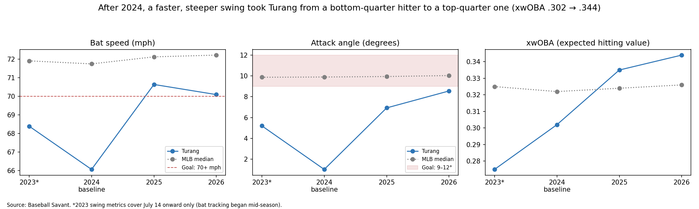
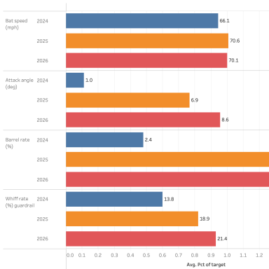
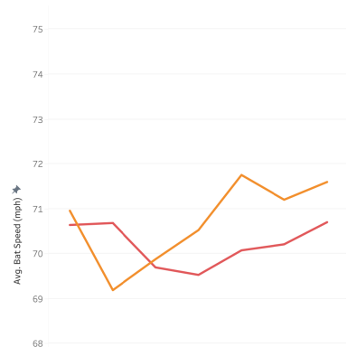
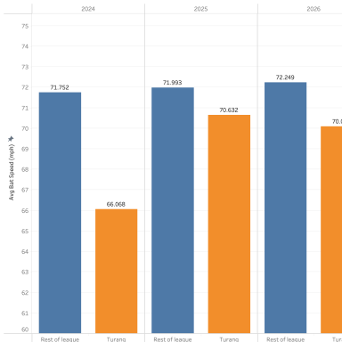

# From the Dugout to the Data

**Omar Morillo Aldana** · Baseball player development analyst in the making

I grew up in Venezuela with a bat, a glove and no metrics. At Point Park University, Blast Motion data and a few small swing changes turned my struggling freshman year into All-Conference seasons. That's why I'm here: I want to find the small changes that transform a player's career, and prove them with data.

This portfolio collects my baseball player development (PD) projects, organized by the tool I used to build them. Same goal in every room: find the one thing a player needs to fix, and show whether it worked.

[LinkedIn](https://www.linkedin.com/in/omar-morillo-203a9124a/) · Morilloaldanaomar@gmail.com · [Leer en español](#en-español)

---

## The Lineup

| Room | Tools | Project | The one-line story |
|---|---|---|---|
| ⚾ [The Player Development Lab](#-the-player-development-lab) | Python · pandas · Matplotlib | [Brice Turang: Hitter Development Plan](player-development-lab/turang-hitter-development-plan/) | A plan built only from 2024 data said "bat speed first." He gained 4.5 mph and his barrel rate tripled. |
| 📊 [The Tableau Dugout](#-the-tableau-dugout) | Tableau | [Turang's Swing Rebuild](tableau-dugout/turang-swing-rebuild/) | The same story, rebuilt as six interactive views a coach can click through. |

---

## ⚾ The Player Development Lab
*Python case studies: the full analysis, from raw Statcast pitches to a development plan.*

### [Brice Turang: Hitter Development Plan](player-development-lab/turang-hitter-development-plan/)

**The question:** after 2024, what was the #1 thing Brice Turang needed to fix in his swing, and how would we know it worked?

**The answer:** bat speed. Across 215 qualified MLB hitters, it had the strongest link to damage (0.73 with barrel rate), and Turang swung 66.1 mph, near the bottom of the league.

**What happened:** 70.6 mph in 2025, held in 2026. Barrel rate 2.4% → 7.9%. xwOBA .302 → .344. 3 of 4 goals met in both seasons.

**Inside:** a 10-step Jupyter notebook, 9,962 pitches, 20 league leaderboards, league benchmarks and percentiles, a goal scorecard, a three-phase drill plan, and a summary in English and Spanish.

→ [Read the project](player-development-lab/turang-hitter-development-plan/) · [Open the notebook](player-development-lab/turang-hitter-development-plan/notebooks/turang_idp.ipynb)

---

## 📊 The Tableau Dugout
*Interactive views built for the people in the dugout: coaches and players who need the answer at a glance.*

### [Turang's Swing Rebuild](tableau-dugout/turang-swing-rebuild/)

| Final results | Bat speed by month | Bat speed vs. the league |
|---|---|---|
|  |  |  |

Six Tableau views built from the clean data of the Python project: the goal scorecard, monthly bat speed and attack angle trends, Turang against the rest of the league, and how faster swings turned into harder contact.

→ [See the workbook](tableau-dugout/turang-swing-rebuild/)

---

## 🔜 On Deck

Projects I'm building next, each in a new tool:

- **The SQL Bullpen:** querying Statcast data with SQL
- **The Pitch Design Lab:** a pitching project grounded in biomechanics
- **The Progress Board:** a player progress dashboard
- **The Year-over-Year Review:** did a program's bat speed gains hold up?

---

## The Toolbox

| Tool | Where you'll see it |
|---|---|
| Python (pandas, NumPy, Matplotlib, Jupyter) | The Player Development Lab |
| Tableau | The Tableau Dugout |
| Baseball Savant / Statcast | Every project |
| Blast Motion, Trackman, Hawk-Eye, ForceDecks | What I trained with as a player and coach |

**Certifications:** Driveline Foundations of Hitting · Driveline Hitting Coach

**Education:** B.S. Business, Point Park University (2025) · M.S. Information Systems, Point Park University (expected 2028)

---

## En español

**Del dugout a los datos.** Crecí en Venezuela con un bate, un guante y sin métricas. En Point Park University, los datos de Blast Motion y unos pocos cambios en mi swing transformaron mi primer año difícil en temporadas All-Conference. Por eso estoy aquí: quiero encontrar los pequeños cambios que transforman la carrera de un jugador y demostrarlos con datos.

- **El Laboratorio de Desarrollo (Python):** [plan de desarrollo de Brice Turang](player-development-lab/turang-hitter-development-plan/), con resumen completo en español.
- **El Dugout de Tableau:** [la reconstrucción del swing de Turang](tableau-dugout/turang-swing-rebuild/) en seis vistas interactivas.
