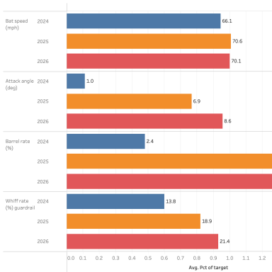
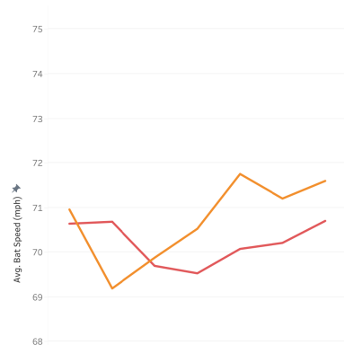
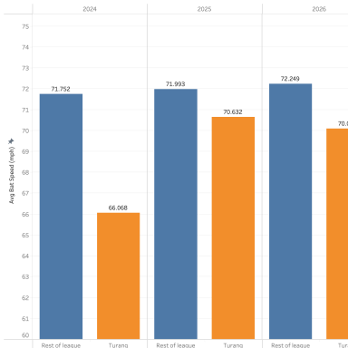
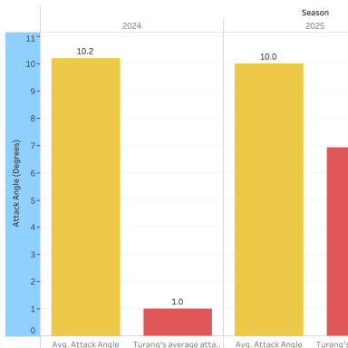
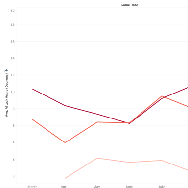
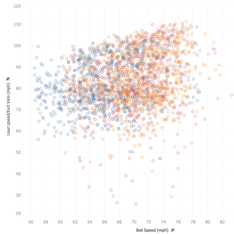

# Turang's Swing Rebuild (Tableau)

The visual companion to my [Brice Turang Hitter Development Plan](../../player-development-lab/turang-hitter-development-plan/). The Python notebook finds the answer; this workbook shows it the way a hitting coach or a player would want to see it.

**The story in one line:** Turang went from 5.7 mph below the league in bat speed (2024) to within about 2 mph (2025–2026), met his bat speed and barrel rate goals, and kept his whiff rate under the limit.

**File:** [`Turang_Swing_Rebuild.twbx`](Turang_Swing_Rebuild.twbx) (packaged workbook: the data travels with it)

## The six views

| View | What it answers |
|---|---|
| **Final results** | Did the plan work? Each goal (bat speed, attack angle, barrel rate, whiff-rate guardrail) as a percent of its target, 2024–2026. |
| **Bat speed by month** | When did the change happen? Bat speed jumped about 4.5 mph in 2025 and held in 2026. |
| **Bat speed vs. league** | How far behind was he? Turang against the rest of the league each season. |
| **Attack angle vs. league** | Is his swing path catching up? His average attack angle against the league average, 2024–2026. |
| **Turang's attack angle by month** | How fast is the path changing? Monthly attack angle climbing from 2024 to 2026. |
| **Bat speed vs. launch speed** | Why bat speed? Every swing plotted: faster swings tended to produce harder contact. |

## Previews

*Thumbnails Tableau saved inside the workbook. Open the .twbx for the full, interactive views.*

| | | |
|---|---|---|
|  |  |  |
|  |  |  |

## Data

All three data sources come from the Python project's cleaned files (Baseball Savant, 2023–2026 regular season):

- `turang_swings_clean.csv`: every competitive Turang swing (bat speed, attack angle, launch speed, game date)
- `league_leaderboards_2023_2026.csv`: league bat tracking and swing path leaderboards
- `turang_scorecard`: the four goals, their targets and each season's result

## How to open it

1. Download [`Turang_Swing_Rebuild.twbx`](Turang_Swing_Rebuild.twbx) (click the file, then the download button).
2. Open it in **Tableau Desktop** or the free **Tableau Public** app. It was saved in Tableau 2026.3, so use that version or newer.

## Skills shown

- Connecting and blending several data sources in one workbook
- Line charts by month, side-by-side bars by season, and a scatter plot of every swing
- Goal tracking against targets (percent of target)
- Titles that state the finding, so the chart answers the question before anyone has to read the axis

**Tools:** Tableau · Baseball Savant (Statcast)
